# Frappe CRM - Software Quality Engineering (SQE) Suite

[](https://github.com/i243137-oss/frappe-crm-sqe/actions/workflows/sqe_quality_gate.yml)
[](docs/TEST_COMPLETION_REPORT.md)
[](docs/UNIT_TEST_REPORT.md)
[](docs/MUTATION_REPORT.md)
[](docs/SONARQUBE_REPORT.md)
[](docs/ACCESSIBILITY_REPORT.md)
[](docs/PERFORMANCE_REPORT.md)

---

## 1. Executive Overview

This repository contains the comprehensive, evidence-based Software Quality Engineering (SQE) project for **Frappe CRM** (`https://github.com/frappe/crm`). The suite implements end-to-end quality assurance across all testing levels—from white-box unit testing and formal condition coverage to API integration, headless browser use case automation, AST mutation testing, static code complexity derivation, WCAG 2.1 AA accessibility auditing, defensive security evaluation, high-concurrency load benchmarking, and defect root cause analysis.

### Target Workflows Under Test
1. **Workflow 1: Convert Lead to Deal (`crm.fcrm.doctype.crm_lead.crm_lead.convert_to_deal`)**
   - Conversion of an active Lead into a new Deal document.
   - Enforces status transition guards, primary contact generation, organization linking, and idempotency policies.
2. **Workflow 2: Update Deal Status (`CRM Deal.validate_lost_reason`, `set_value`)**
   - Progression through pipeline stages (`Qualification`, `Open`, `Won`, `Lost`).
   - Enforces business rule validation: mandatory lost reasons, mandatory explanatory notes when reason is `Other`, automated win date assignment, default probability calculation, and duration audit logging.
3. **Shared Data Relationship & Persistence Integrity**
   - Foreign key linkage (`deal.lead == lead.name`) preservation without duplication.
   - Atomic transaction rollbacks preventing orphaned records under database disconnection or network timeout faults.

---

## 2. Project Group Members & Contributors

| Contributor Name | Role & Quality Engineering Specialization |
| :--- | :--- |
| **Umair Hassan** | **Lead Quality Engineer:** Test Infrastructure, CI/CD Quality Gates, Architecture Discovery & Defensive Security Assessment |
| **Abdullah** | **Test Automation Engineer:** White-Box Unit Testing, API/Integration Testing, OpenAPI Data Generator & AST Mutation Quality Gates |
| **Muhammad Anas** | **Quality & Performance Analyst:** WCAG 2.1 AA Usability/Accessibility, k6 Load Benchmarking, Fault Recovery & Defect Root Cause Analysis |

---

## 3. Master Deliverables Directory

The repository is structured to maintain complete isolation between upstream Frappe CRM logic and all team-authored test harnesses, mock runtimes, synthetic generators, and documentation:

```
frappe-crm-sqe/
├── .github/workflows/          # GitHub Actions CI Quality Gate
│   └── sqe_quality_gate.yml
├── docs/                       # Complete SQE engineering documentation
│   ├── performance/            # Raw k6 JSON performance metrics
│   ├── PROJECT_ANALYSIS.md     # Architecture & workflow discovery
│   ├── REQUIREMENTS.md         # Functional & non-functional requirements
│   ├── BUSINESS_RULES.md       # Formal business rules (MCC & MC/DC truth tables)
│   ├── USER_ROLES.md           # Role-Based Access Control (RBAC) matrix
│   ├── TEST_PLAN.md            # IEEE 829 test plan & quality strategies
│   ├── RISK_REGISTER.md        # Risk assessment & mitigations
│   ├── TRACEABILITY_MATRIX.md  # Bidirectional Requirements Traceability Matrix (RTM)
│   ├── TEST_CASES.md           # Consolidated test case catalog
│   ├── USE_CASE_SPECIFICATION.md# End-to-end formal use case specifications
│   ├── UNIT_TEST_REPORT.md     # White-box testing, 100% statement & branch coverage
│   ├── API_TEST_REPORT.md      # REST/RPC API integration test report
│   ├── DATA_GENERATOR_REPORT.md# OpenAPI 3.0 test data generator suite
│   ├── E2E_USE_CASE_REPORT.md  # Playwright browser use case automation
│   ├── MUTATION_REPORT.md      # AST mutation runner & 100% kill score analysis
│   ├── SONARQUBE_REPORT.md     # Static analysis, CFG & cyclomatic complexity V(G)=7
│   ├── ACCESSIBILITY_REPORT.md # axe-core WCAG 2.1 AA audit & Lighthouse scores
│   ├── SECURITY_REPORT.md      # RBAC decisions, cookie flags, OWASP ZAP passive scans
│   ├── PERFORMANCE_REPORT.md   # k6 OSS load tests & failure/recovery report
│   ├── DEFECT_REPORT.md        # IEEE 829 defect tracking log
│   ├── ROOT_CAUSE_ANALYSIS.md  # 5 Whys, Ishikawa (Fishbone) diagram, Pareto analysis
│   ├── TEST_COMPLETION_REPORT.md# Final quality completion summary & sign-off
│   ├── AI_USE_RECORD.md        # Academic transparency & AI audit trail
│   └── WEEKLY_PROGRESS.md      # Chronological development milestone tracker
├── tests/team/                 # Isolated test engineering suites
│   ├── a11y/                   # axe-core WCAG 2.1 AA automated tests
│   ├── api/                    # REST/RPC API integration tests & cross-workflow tests
│   ├── data/                   # Synthetic JSON test datasets & OpenAPI schemas
│   ├── e2e/                    # Playwright browser automation & mock HTTP server
│   ├── fixtures/               # Mock Frappe runtime environment & synthetic factories
│   ├── generator/              # OpenAPI synthetic test data generator
│   ├── mutation/               # Targeted AST mutation testing runner
│   ├── performance/            # k6 JavaScript load scripts & fault recovery tests
│   ├── security/               # RBAC matrix, cookie flags & OWASP ZAP rule engine
│   └── unit/                   # White-box unit tests, MCC/MCDC & BVA verification
└── requirements.txt            # Unified Python testing dependencies
```

---

## 4. Comprehensive Deliverables Index

| # | Deliverable Document | Focus & Methodology | Status |
| :-: | :--- | :--- | :-: |
| 1 | [`docs/PROJECT_ANALYSIS.md`](docs/PROJECT_ANALYSIS.md) | Architecture discovery, upstream commit analysis, and DocType schemas | **Completed** |
| 2 | [`docs/REQUIREMENTS.md`](docs/REQUIREMENTS.md) | 9 functional and non-functional requirements with acceptance criteria | **Completed** |
| 3 | [`docs/BUSINESS_RULES.md`](docs/BUSINESS_RULES.md) | Business logic specification (BR-01 to BR-04) with MCC and MC/DC tables | **Completed** |
| 4 | [`docs/USER_ROLES.md`](docs/USER_ROLES.md) | Role-Based Access Control (RBAC) permission query conditions | **Completed** |
| 5 | [`docs/TEST_PLAN.md`](docs/TEST_PLAN.md) | IEEE 829 test strategy, entry/exit criteria, and resource allocation | **Completed** |
| 6 | [`docs/RISK_REGISTER.md`](docs/RISK_REGISTER.md) | Project and product risks with probability, impact, and mitigations | **Completed** |
| 7 | [`docs/TRACEABILITY_MATRIX.md`](docs/TRACEABILITY_MATRIX.md) | Full bidirectional Requirements Traceability Matrix (RTM) | **Completed** |
| 8 | [`docs/TEST_CASES.md`](docs/TEST_CASES.md) | Detailed test specifications across unit, API, E2E, and security | **Completed** |
| 9 | [`docs/USE_CASE_SPECIFICATION.md`](docs/USE_CASE_SPECIFICATION.md) | Detailed formal use cases for Lead Conversion and Deal Lifecycle | **Completed** |
| 10 | [`docs/UNIT_TEST_REPORT.md`](docs/UNIT_TEST_REPORT.md) | 73 tests (100% statement and branch coverage, 10-row MCC, 4 MC/DC pairs, state matrix) | **Completed** |
| 11 | [`docs/API_TEST_REPORT.md`](docs/API_TEST_REPORT.md) | 24 REST/RPC API tests, 3-point BVA, EP, and cross-workflow integration | **Completed** |
| 12 | [`docs/DATA_GENERATOR_REPORT.md`](docs/DATA_GENERATOR_REPORT.md) | OpenAPI 3.0 specification (`docs/openapi_crm.yaml`) and synthetic generator | **Completed** |
| 13 | [`docs/E2E_USE_CASE_REPORT.md`](docs/E2E_USE_CASE_REPORT.md) | 6 Playwright browser scenarios (Happy Path, Alternative, Exception flows) | **Completed** |
| 14 | [`docs/MUTATION_REPORT.md`](docs/MUTATION_REPORT.md) | Targeted AST mutation runner, 16/16 mutants killed (100.0% score) | **Completed** |
| 15 | [`docs/SONARQUBE_REPORT.md`](docs/SONARQUBE_REPORT.md) | SonarQube Quality Gate Passed, CFG derivations, $V(G)=7$, 0 lint errors | **Completed** |
| 16 | [`docs/ACCESSIBILITY_REPORT.md`](docs/ACCESSIBILITY_REPORT.md) | axe-core WCAG 2.1 AA audit, contrast remediation, Lighthouse 100/96/100 | **Completed** |
| 17 | [`docs/SECURITY_REPORT.md`](docs/SECURITY_REPORT.md) | RBAC access decisions, cookie flags, CSRF, OWASP ZAP passive scans | **Completed** |
| 18 | [`docs/PERFORMANCE_REPORT.md`](docs/PERFORMANCE_REPORT.md) | k6 OSS load tests (13,199 reqs, p95 1.6-4.4ms), controlled recovery suite | **Completed** |
| 19 | [`docs/DEFECT_REPORT.md`](docs/DEFECT_REPORT.md) | IEEE 829 defect tracking log with severity/priority classifications | **Completed** |
| 20 | [`docs/ROOT_CAUSE_ANALYSIS.md`](docs/ROOT_CAUSE_ANALYSIS.md) | 5 Whys analysis, Ishikawa (Fishbone) diagram, Pareto defect distribution | **Completed** |
| 21 | [`docs/TEST_COMPLETION_REPORT.md`](docs/TEST_COMPLETION_REPORT.md) | Final test completion synthesis, metrics dashboard, and sign-off | **Completed** |
| 22 | [`docs/AI_USE_RECORD.md`](docs/AI_USE_RECORD.md) | Academic transparency log detailing AI assistance and verification | **Completed** |
| 23 | [`docs/WEEKLY_PROGRESS.md`](docs/WEEKLY_PROGRESS.md) | Chronological development milestone tracker | **Completed** |

---

## 5. Test Suite Execution & Local Reproduction

### Upstream Baseline & License
- **Upstream Repository:** `https://github.com/frappe/crm`
- **Pinned Commit Hash:** `678ed0d5c99097674ce45dbbc502d8d2afee927d`
- **Upstream License:** GNU Affero General Public License v3.0 (AGPLv3)
- **Repository Isolation Policy:** Upstream CRM codebase resides in `crm/`. All team tests, test harnesses, and documentation are strictly isolated in `tests/team/` and `docs/`.

### Prerequisites
- Python 3.12+
- Node.js 18+ (for k6 and Playwright browser engines)
- Git

### Installation
```bash
# Clone the SQE repository
git clone https://github.com/i243137-oss/frappe-crm-sqe.git
cd frappe-crm-sqe

# Clone and pin the exact upstream Frappe CRM baseline commit
git clone https://github.com/frappe/crm crm
cd crm && git checkout 678ed0d5c99097674ce45dbbc502d8d2afee927d && cd ..

# Install Python dependencies
pip install -r requirements.txt

# Install Playwright browser binaries
playwright install --with-deps chromium
```

### Starting the Application, Seeding Test Data & Resetting State

In adherence to SQE specification requirements (*"Document the commands for installation, starting the application, seeding test data, and resetting it between runs"*):

#### 1. Starting the Application
- **Standard Frappe Bench Environment (Full Stack):**
  ```bash
  cd /path/to/frappe-bench
  bench start
  # Production application runs at: http://localhost:8000
  ```
- **Lightweight Test Harness UI (for isolated E2E and visual accessibility inspection):**
  ```bash
  python tests/team/e2e/mock_server.py
  # Harness UI runs at: http://127.0.0.1:9123
  ```

#### 2. Seeding Test Data
To systematically synthesize and seed test fixtures (synthetic leads, deals, 3-point BVA, and equivalence partitions):
```bash
python tests/team/generator/data_generator.py
# Generates structured OpenAPI test fixtures in: tests/team/data/generated_api_payloads.json
```

#### 3. Resetting Test Data Between Runs
- **Frappe Bench Database Reset:**
  ```bash
  bench --site crm.localhost reinstall --yes
  bench --site crm.localhost migrate
  ```
- **Automated Test Environment Reset:**
  Every test run automatically resets database tables and session state between tests via `autouse=True` fixtures in `tests/team/fixtures/mock_frappe.py`:
  ```bash
  python -c "from tests.team.fixtures.mock_frappe import mock_db; mock_db.reset(); print('Database tables reset to initial state')"
  ```

### Running Test Suites

#### 1. White-Box Unit Testing & Coverage
```bash
# Execute unit tests and verify statement and branch coverage on Frappe CRM core logic
pytest tests/team/unit/ -v --cov=crm.fcrm.doctype.crm_deal.crm_deal --cov=crm.fcrm.doctype.crm_lead.crm_lead --cov-branch --cov-report=term-missing
```

#### 2. REST & RPC API Integration Testing
```bash
# Execute API tests covering BVA, EP, and cross-workflow pipelines
pytest tests/team/api/ -v
```

#### 3. Synthetic OpenAPI Test Data Generator
```bash
# Run data generator and execute verification suite
python tests/team/generator/data_generator.py
pytest tests/team/generator/ -v
```

#### 4. Playwright End-to-End Browser Automation
```bash
# Execute headless browser tests (Happy path, 2 alternative, 2 exception, escape dismissal)
pytest tests/team/e2e/test_crm_use_cases_playwright.py -v
```

#### 5. Usability & Accessibility (a11y) Audits
```bash
# Run axe-core WCAG 2.1 AA audit
pytest tests/team/a11y/ -v
```

#### 6. Defensive Security Assessment
```bash
# Run RBAC matrix, cookie inspection, CSRF and OWASP ZAP passive scanner
pytest tests/team/security/ -v
```

#### 7. Controlled Failure and Recovery Testing
```bash
# Verify atomic rollback and idempotency recovery under simulated faults
pytest tests/team/performance/test_failure_and_recovery.py -v
```

#### 8. High-Volume Workload Benchmarking (k6)
```bash
# Run 4-stage k6 load benchmark (1 VU and 5 VUs, 60s each)
python tests/team/performance/run_k6_benchmarks.py
```

#### 9. AST Mutation Testing Quality Gate
```bash
# Execute 16 targeted AST business rule mutants
python tests/team/mutation/mutation_runner.py
```

#### 10. Static Code Analysis & Complexity
```bash
# Verify Cyclomatic Complexity and linting standards
radon cc tests/team crm_deal crm_lead -a -nc --max B
flake8 tests/team --count --select=E9,F63,F7,F82 --show-source --statistics
```

---

## 6. Summary of Quality Metrics

| Engineering Dimension | Pre-defined Target | Achieved Metric | Evaluation Status |
| :--- | :--- | :--- | :---: |
| **Total Test Cases** | $\ge 50$ tests | **139 / 139 Passing** | **PASSED (100%)** |
| **Branch Coverage** | $\ge 80.0\%$ | **100.0%** | **PASSED** |
| **Statement Coverage**| $\ge 80.0\%$ | **100.0%** | **PASSED** |
| **Mutation Score** | $\ge 80.0\%$ | **100.0% (16/16 Killed)** | **PASSED** |
| **MCC Rows Verified** | Full condition table | **10 / 10 Rows Passed** | **PASSED** |
| **MC/DC Pairs** | 4 independent pairs | **4 / 4 Pairs Verified** | **PASSED** |
| **Cyclomatic Complexity**| $V(G) \le 10$ (Grade A/B) | **$V(G) = 7$ (Grade A)** | **PASSED** |
| **Accessibility Audit**| 0 Critical WCAG Violations | **0 Violations (WCAG 2.1 AA)**| **PASSED** |
| **Lighthouse Score** | $\ge 90 / 100$ | **100 / 96 / 100** | **PASSED** |
| **Defensive Security**| Full RBAC & OWASP ZAP | **7 / 7 Checks Passed** | **PASSED** |
| **Load Latency ($p95$)**| $< 300\text{ ms}$ | **$1.60 - 4.36\text{ ms}$** | **PASSED** |
| **Load Failure Rate** | $< 1.00\%$ | **$0.00\%$ (13,199 reqs)** | **PASSED** |
| **Fault Recovery** | 100% Atomic Rollback | **Zero Orphan Records** | **PASSED** |

---

## 7. Continuous Integration Workflow

The GitHub Actions CI Quality Gate ([`.github/workflows/sqe_quality_gate.yml`](.github/workflows/sqe_quality_gate.yml)) enforces strict quality checks on every push and pull request against `dev` and `main`:

```mermaid
flowchart LR
    A["Code Push / PR"] --> B["Clone Upstream CRM"]
    B --> C["Install Dependencies"]
    C --> D["Unit Tests & Coverage (>=80%)"]
    D --> E["API & Integration Tests"]
    E --> F["OpenAPI Generator Suite"]
    F --> G["Playwright E2E Tests"]
    G --> H["a11y WCAG 2.1 AA Audit"]
    H --> I["Security & OWASP ZAP"]
    I --> J["Failure & Recovery Tests"]
    J --> K["Mutation Testing (100% Kill)"]
    K --> L["Static Complexity & Linting"]
    L --> M["Quality Gate PASSED"]
```



---

## 8. Viva Voce Defense Key Reference Guide

- **Cyclomatic Complexity Derivation:** Evaluated via three independent mathematical formalisms ($M = E - N + 2P$, $M = P + 1$, and Closed Regions $+ 1$) on `validate_lost_reason`, yielding exactly $V(G) = 7$ across 7 independent basis execution paths.
- **MC/DC Formal Proof:** Four independent condition pairs for BR-02 ($A$: status is Lost, $B$: lost reason provided, $C$: reason is Other, $D$: explanatory notes provided) isolating the distinct outcome toggle of each condition while keeping all others constant.
- **3-Point Boundary Value Analysis:** Evaluated for BR-01 at $-0.01$ (rejected), $0.00$ (accepted boundary), and $+0.01$ (accepted above boundary) across `deal_value`, `expected_deal_value`, `annual_revenue`, `total`, and `net_total`.
- **Fault Recovery Atomicity:** Mid-transaction fault injections prove that database write crashes trigger immediate rollbacks leaving zero orphaned Deal records, while network retry timeouts are handled idempotently to guarantee zero duplicate entity creation.
