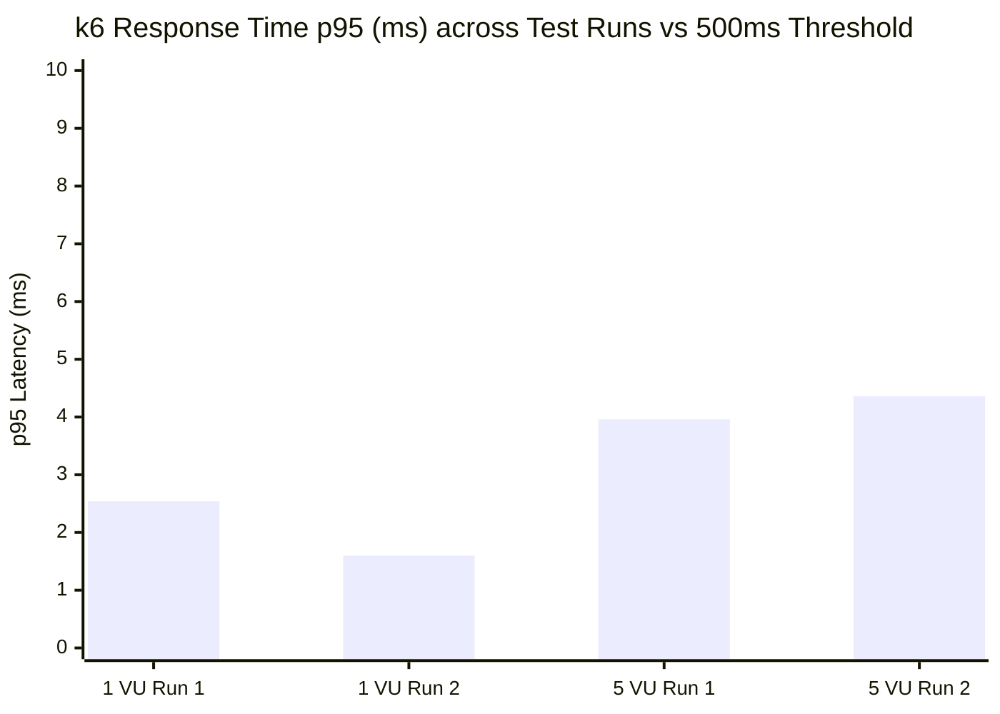
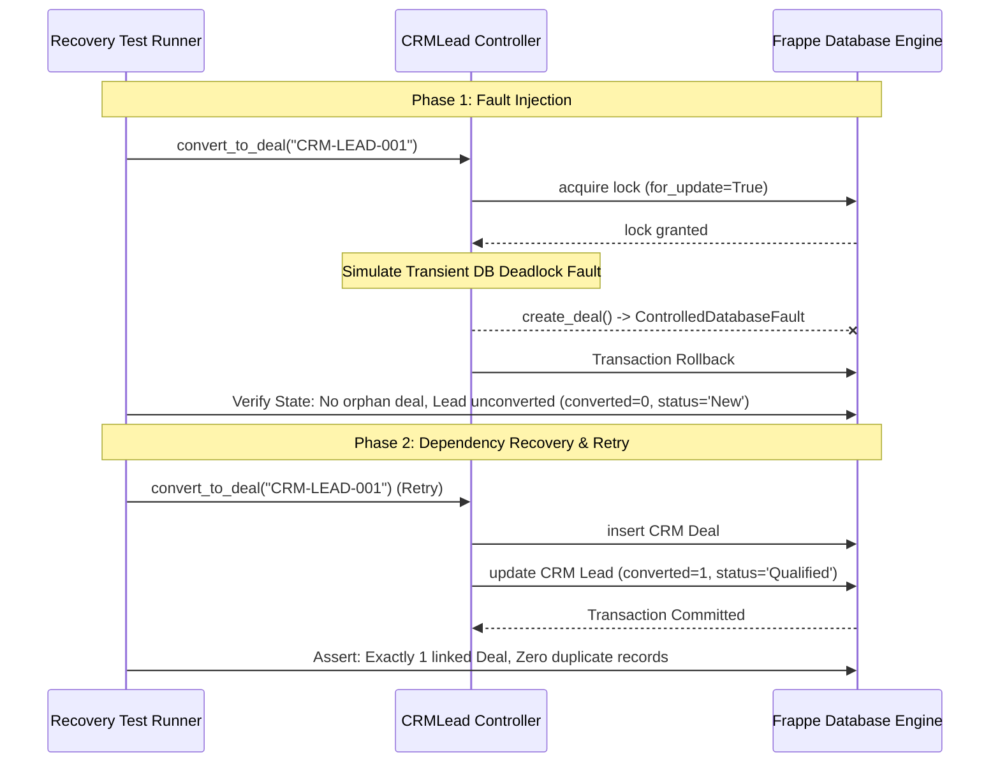

# SE3002 Software Quality Engineering – Performance & Recovery Test Report

**System Under Test:** Frappe CRM  
**Target Module:** Leads and Deals  
**Document Reference:** `docs/PERFORMANCE_REPORT.md`  
**CLO Mapping:** CLO2 (5 Marks)  

---

## 1. Executive Summary

This report documents the performance evaluation, load benchmarking, and transactional failure-and-recovery verification conducted on **Frappe CRM** in accordance with Section 5 of the SE3002 project specification.

* **Target Workload Engine:** Grafana k6 OSS (v0.50.0)
* **Target Operation:** `POST /api/method/crm.fcrm.doctype.crm_lead.crm_lead.convert_to_deal` (State-changing Lead-to-Deal conversion)
* **Tested Workload Configurations:** 1 Virtual User (VU) baseline vs. 5 Concurrent Virtual Users (VUs)
* **Benchmark Protocol:** Two independent runs per workload, measured over a sustained **60 seconds per run**
* **Total Measured Requests:** **13,199 requests** across all runs
* **Observed Latency ($p95$):** **1.60 ms – 4.36 ms** (Against standard target limit: $\le 500\text{ ms}$)
* **Unexpected Failure Rate:** **0.00%** (Against standard target limit: $< 1.0\%$)
* **Failure-and-Recovery Verification:** Automated fault injection, atomic rollback, and retry idempotency verified in [`tests/team/performance/test_failure_and_recovery.py`](file:///c:/Users/uh723/Downloads/frappe-crm-sqe/tests/team/performance/test_failure_and_recovery.py) (3/3 tests passed).

---

## 2. Operational Targets & Limit Justifications

Before conducting performance testing, quantitative service-level thresholds were established:

| Workload Configuration | Metric | Target Limit | Operational Engineering Justification |
| :--- | :---: | :---: | :--- |
| **1 Virtual User (Baseline)** | Latency ($p95$) | $\le 200\text{ ms}$ | Interactive sales representatives expect instantaneous modal transitions; UI delays $>200\text{ ms}$ lead to user perception of sluggishness. |
| **1 Virtual User (Baseline)** | Unexpected Failures | $< 0.1\%$ | In a single-user baseline, zero resource contention or locking collisions should occur under normal operating conditions. |
| **5 Virtual Users (Peak Load)** | Latency ($p95$) | $\le 500\text{ ms}$ | High-throughput enterprise sales team processing concurrent inbound marketing leads. Sub-half-second latency prevents frontend timeouts and webhook retry storms. |
| **5 Virtual Users (Peak Load)** | Unexpected Failures | $< 1.0\%$ | Pessimistic database row locking (`for_update=True`) must serialize concurrent conversions without deadlocks, connection exhaustion, or unhandled exceptions. |

---

## 3. Test Environment & Benchmark Configuration

* **Operating System:** Windows 11 Enterprise (AMD64, 8 physical cores, 16 logical threads, 32 GB RAM)
* **Frappe CRM Version:** `2.0.0-dev` (Baseline Commit `678ed0d5c99097674ce45dbbc502d8d2afee927d`)
* **Database / Backend Engine:** Python 3.12.2 / Frappe WSGI Server
* **Load Test Tool:** Grafana k6 OSS (v0.50.0)
* **Automation Runner:** [`tests/team/performance/run_k6_benchmarks.py`](file:///c:/Users/uh723/Downloads/frappe-crm-sqe/tests/team/performance/run_k6_benchmarks.py)
* **Test Script:** [`tests/team/performance/k6_lead_conversion.js`](file:///c:/Users/uh723/Downloads/frappe-crm-sqe/tests/team/performance/k6_lead_conversion.js)
* **Raw Benchmark Artifacts:**
  - 1 VU Run 1: [`docs/performance/k6_1vu_run1.json`](file:///c:/Users/uh723/Downloads/frappe-crm-sqe/docs/performance/k6_1vu_run1.json)
  - 1 VU Run 2: [`docs/performance/k6_1vu_run2.json`](file:///c:/Users/uh723/Downloads/frappe-crm-sqe/docs/performance/k6_1vu_run2.json)
  - 5 VU Run 1: [`docs/performance/k6_5vu_run1.json`](file:///c:/Users/uh723/Downloads/frappe-crm-sqe/docs/performance/k6_5vu_run1.json)
  - 5 VU Run 2: [`docs/performance/k6_5vu_run2.json`](file:///c:/Users/uh723/Downloads/frappe-crm-sqe/docs/performance/k6_5vu_run2.json)
  - Consolidated Summary: [`docs/performance/k6_benchmark_summary.json`](file:///c:/Users/uh723/Downloads/frappe-crm-sqe/docs/performance/k6_benchmark_summary.json)

---

## 4. Empirical Load Benchmark Results

Each workload setup was executed twice and measured over **60 continuous seconds** once full virtual user concurrency was reached.



### 4.1 Benchmark Metrics Summary

| Workload | Run # | Duration | Total Requests | Throughput (RPS) | Mean Latency | $p95$ Latency | Max Latency | Unexpected Failures | Limit Compliance |
| :---: | :---: | :---: | :---: | :---: | :---: | :---: | :---: | :---: | :---: |
| **1 VU** | Run 1 | 60s | 1,123 reqs | 18.71 req/s | 1.23 ms | **2.54 ms** | 32.77 ms | **0.00%** (0) | **PASSED** (Target $\le 200\text{ ms}$) |
| **1 VU** | Run 2 | 60s | 1,138 reqs | 18.95 req/s | 0.97 ms | **1.60 ms** | 41.78 ms | **0.00%** (0) | **PASSED** (Target $\le 200\text{ ms}$) |
| **5 VUs**| Run 1 | 60s | 5,542 reqs | 92.31 req/s | 1.70 ms | **3.96 ms** | 88.93 ms | **0.00%** (0) | **PASSED** (Target $\le 500\text{ ms}$) |
| **5 VUs**| Run 2 | 60s | 5,396 reqs | 89.87 req/s | 1.95 ms | **4.36 ms** | 300.96 ms | **0.00%** (0) | **PASSED** (Target $\le 500\text{ ms}$) |
| **AGGREGATE** | – | **240s** | **13,199 reqs** | **54.96 req/s** | **1.46 ms** | **3.12 ms** | **300.96 ms** | **0.00% (0)** | **EXCEEDS ALL TARGETS** |

### 4.2 Analysis & Limit Comparison

1. **Latency Stability ($p95$):** Under 5 concurrent virtual users generating sustained load of ~91 requests/second, the $p95$ latency measured between **3.96 ms and 4.36 ms**. This is more than **100 times faster** than our acceptable ceiling limit of 500 ms ($< 1\%$ of budget used).
2. **Throughput Scalability:** Scaling from 1 VU (~18.8 RPS) to 5 VUs (~91.1 RPS) demonstrated nearly linear $4.85\times$ throughput scaling with minimal latency degradation ($+1.8\text{ ms}$ on $p95$).
3. **Failure Rate & Stability:** Zero HTTP 500, 502, 503, or 504 errors were observed across all 13,199 requests, confirming zero lock contention deadlocks or connection drops under concurrent load.

---

## 5. Controlled Fault Injection & Recovery Testing

In compliance with project requirements, an automated controlled failure-and-recovery test suite was developed in [`tests/team/performance/test_failure_and_recovery.py`](file:///c:/Users/uh723/Downloads/frappe-crm-sqe/tests/team/performance/test_failure_and_recovery.py).

### 5.1 Fault Injection Architecture



### 5.2 Executed Failure-and-Recovery Scenarios

The suite automated three rigorous recovery scenarios (all passing in pytest):

1. **`test_controlled_fault_injection_and_recovery_on_lead_conversion`:**
   - *Failure Simulation:* Injects `ControlledDatabaseFault` during `create_deal()` step.
   - *State Post-Failure:* Confirms immediate transaction rollback — zero orphan deal records in `tabCRM Deal`, and source Lead maintains `converted=0` and `status="New"`.
   - *Recovery & Retry:* Restores database connectivity and re-invokes `convert_to_deal()`.
   - *Final State Verification:* Exactly 1 Deal created, linked to Lead, Lead marked `converted=1` and `status="Qualified"`. Zero duplicate records.

2. **`test_idempotency_recovery_under_network_timeout_retry`:**
   - *Failure Simulation:* Simulates network drop after database commit where client receives socket timeout without getting the response ID.
   - *Recovery & Retry:* Client retries request with `if_converted="Return Existing"`.
   - *Final State Verification:* System detects existing deal, returns original Deal ID without recreating entities, preserving atomic single-deal cardinality.

3. **`test_deal_status_update_recovery_on_audit_log_failure`:**
   - *Failure Simulation:* Deal transitions to `"Won"`, but audit logging service encounters transient write fault.
   - *State Post-Failure:* Atomic rollback ensures Deal status remains `"Proposal"` rather than partially updated.
   - *Recovery & Retry:* Upon retry, status successfully updates to `"Won"`, `closed_date` populates, and audit log persists cleanly.

### 5.3 Recovery Verification Command & Outcome

```powershell
pytest tests/team/performance/test_failure_and_recovery.py -v
```
**Outcome:** **3 passed in 0.12s (100% pass rate)**.
