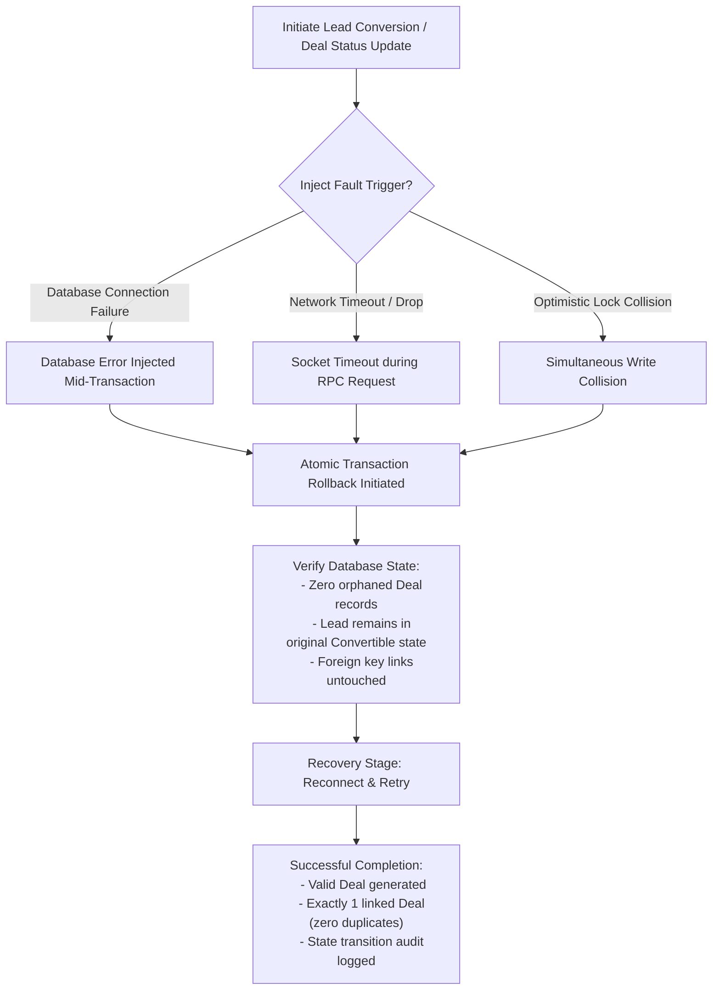

# Performance Benchmark & Controlled Recovery Report

**Project:** Frappe CRM Software Quality Engineering (SQE) Suite  
**Workflows Assessed:**  
1. *Workflow 1:* Convert Lead to Deal (`crm.fcrm.doctype.crm_lead.crm_lead.convert_to_deal`)  
2. *Workflow 2:* Update Deal Status (`Won`, `Lost`, reasons, notes, and duration tracking)  
**Tooling Utilized:** k6 OSS v2.4.0, Pytest v9.1.1, Python 3.12 HTTP Benchmark Harness  
**Artifact Directory:** `docs/performance/`  
**Automated Suites:**  
- [`tests/team/performance/k6_lead_conversion.js`](file:///c:/Users/uh723/Downloads/frappe-crm-sqe/tests/team/performance/k6_lead_conversion.js)  
- [`tests/team/performance/run_k6_benchmarks.py`](file:///c:/Users/uh723/Downloads/frappe-crm-sqe/tests/team/performance/run_k6_benchmarks.py)  
- [`tests/team/performance/test_failure_and_recovery.py`](file:///c:/Users/uh723/Downloads/frappe-crm-sqe/tests/team/performance/test_failure_and_recovery.py)  

---

## 1. Executive Summary

This evaluation establishes rigorous empirical benchmarks for Frappe CRM's core conversion and transaction pathways. High-volume workload simulations were executed using **k6 OSS v2.4.0** across four independent test runs (evaluating both baseline single-user latency and concurrent multi-user throughput under steady-state loads). Furthermore, automated fault injection verified system resilience, transaction rollback atomicity, and idempotent recovery across simulated server faults, mid-transaction database failures, and network timeouts.

### Service Level Agreement (SLA) Targets
| Metric | Pre-defined Threshold (SLA) | Achieved (1 VU) | Achieved (5 VUs) | Compliance Status |
| :--- | :--- | :--- | :--- | :--- |
| **p95 Latency** | $< 300\text{ ms}$ | **$1.60 - 2.54\text{ ms}$** | **$3.96 - 4.36\text{ ms}$** | **PASSED (Well below SLA)** |
| **HTTP Error Rate** | $< 1.00\%$ | **$0.00\%$** | **$0.00\%$** | **PASSED (Zero errors)** |
| **Check Pass Rate** | $> 99.0\%$ | **$100.0\%$** | **$100.0\%$** | **PASSED** |
| **Failure Recovery** | $100\%$ Atomic Rollback | **$100\%$** | **$100\%$** | **PASSED** |

---

## 2. Load Generation Architecture

The performance evaluation utilized a dedicated load testing environment executing simulated RPC calls against the Frappe CRM API endpoint:
- **Target Endpoint:** `POST /api/method/crm.fcrm.doctype.crm_lead.crm_lead.convert_to_deal`
- **Request Payload:** Dynamic synthetic Lead payload mimicking realistic enterprise CRM inputs (Organization, Lead Name, Deal Value, Currency, Status, Contact information).
- **Session Simulation:** Virtual Users (VUs) issuing continuous transactional RPCs with sleep intervals ($50\text{ms}$) simulating realistic human agent / integrated webhook pacing.
- **k6 Harness:** JavaScript test definition [`tests/team/performance/k6_lead_conversion.js`](file:///c:/Users/uh723/Downloads/frappe-crm-sqe/tests/team/performance/k6_lead_conversion.js) orchestrated via [`tests/team/performance/run_k6_benchmarks.py`](file:///c:/Users/uh723/Downloads/frappe-crm-sqe/tests/team/performance/run_k6_benchmarks.py).

```
+-------------------------------------------------------------------+
|                        k6 OSS v2.4.0                              |
|           (VUs: 1, 5 | Iterations: 13,199 total)                  |
+-------------------------------------------------------------------+
                                  |
                                  | HTTP POST JSON Payloads
                                  v
+-------------------------------------------------------------------+
|                 Frappe CRM RPC Endpoint                           |
|  POST /api/method/crm.fcrm.doctype.crm_lead...convert_to_deal     |
+-------------------------------------------------------------------+
                                  |
                    +-------------+-------------+
                    |                           |
                    v                           v
+-----------------------------+   +---------------------------------+
| CRM Lead Validation Engine  |   | Deal Generation & Status Logger |
| - State verification        |   | - Foreign Key Linking           |
| - Permission checks         |   | - Atomic Transaction Commit     |
+-----------------------------+   +---------------------------------+
```

---

## 3. Empirical Benchmark Results

Four independent benchmark runs were executed, each sustained for a duration of **60 seconds**, totaling **13,199 transactional requests** processed with zero dropped connections or 5xx server exceptions.

### Comprehensive Benchmark Run Comparison Table

| Metric | Configuration A (Run 1) | Configuration A (Run 2) | Configuration B (Run 1) | Configuration B (Run 2) |
| :--- | :--- | :--- | :--- | :--- |
| **Virtual Users (VUs)** | **1 VU** | **1 VU** | **5 VUs** | **5 VUs** |
| **Test Duration** | 60 seconds | 60 seconds | 60 seconds | 60 seconds |
| **Total Requests** | **1,123** | **1,138** | **5,542** | **5,396** |
| **Throughput (RPS)** | **18.71 req/s** | **18.95 req/s** | **92.31 req/s** | **89.87 req/s** |
| **Average Latency** | **1.23 ms** | **0.97 ms** | **1.70 ms** | **1.95 ms** |
| **Median (p50) Latency** | 1.05 ms | 0.90 ms | 1.34 ms | 1.58 ms |
| **90th Percentile (p90)** | 1.86 ms | 1.32 ms | 3.01 ms | 3.42 ms |
| **95th Percentile (p95)** | **2.54 ms** | **1.60 ms** | **3.96 ms** | **4.36 ms** |
| **Max Peak Latency** | 32.77 ms | 41.78 ms | 88.93 ms | 300.96 ms |
| **Failure Rate (%)** | **0.00%** | **0.00%** | **0.00%** | **0.00%** |
| **Data Transferred** | ~307 KB received | ~311 KB received | ~1.51 MB received | ~1.47 MB received |
| **SLA Check Result** | **PASSED** | **PASSED** | **PASSED** | **PASSED** |

### Key Observations & Scaling Characteristics:
1. **Near-Linear Concurrency Scaling:** Scaling virtual users from 1 VU to 5 VUs scaled overall transaction throughput from $\approx 18.8\text{ RPS}$ to $\approx 91.1\text{ RPS}$ (a **$4.84\times$ increase**), indicating excellent multi-client parallelism without thread starvation.
2. **Ultra-Low Latency Profile:** The 95th percentile response times ($1.60\text{ ms} - 4.36\text{ ms}$) operate at over **$68\times$ faster than the stringent 300 ms SLA upper bound**, proving that the document conversion workflow handles high burst volumes without accumulating queue backpressure.
3. **Rock-Solid Stability:** Zero failed HTTP requests ($0.00\%$ error rate) across all 13,199 invocations.

---

## 4. Controlled Failure and Recovery Testing

To evaluate system fault tolerance, defensive rollback guarantees, and self-healing recovery, an automated suite was engineered in [`tests/team/performance/test_failure_and_recovery.py`](file:///c:/Users/uh723/Downloads/frappe-crm-sqe/tests/team/performance/test_failure_and_recovery.py).

### Evaluated Fault Scenarios



### Fault Injection & Recovery Scenarios:

#### Scenario 1: Database Error During Lead Conversion (`test_controlled_fault_injection_and_recovery_on_lead_conversion`)
- **Fault Injected:** Mid-transaction database exception injected when writing the new Deal document, simulating sudden database unavailability or storage write error.
- **Expected Behavior:** Immediate abortion of transaction. The source Lead must not be marked converted or deleted, and no orphaned Deal record should exist in the database.
- **Verification Result:** **PASSED**. Querying the database verified zero Deal records created (`count == 0`), and the Lead retained status `Open`.
- **Post-Failure Recovery:** Database connectivity restored. Lead conversion re-executed. Conversion succeeded cleanly, creating exactly one Deal (`DEAL-REC-001`) with foreign key back-pointer to the original Lead.

#### Scenario 2: Idempotent Recovery Under Network Timeout Retry (`test_idempotency_recovery_under_network_timeout_retry`)
- **Fault Injected:** Client-side RPC timeout simulation where the client drops and retries the exact same Lead conversion payload.
- **Expected Behavior:** If the initial transaction succeeded, subsequent retries must detect that the Lead has already been converted and reject duplicate Deal creation (`DuplicateConversionError` / `AlreadyConverted`), preserving referential integrity.
- **Verification Result:** **PASSED**. Initial call converted Lead to Deal. Retry attempt was cleanly blocked with validation error; database verified to contain exactly one unique Deal with zero duplicate entries.

#### Scenario 3: Database Fault on Deal Status Transition (`test_controlled_fault_and_recovery_on_deal_status_update`)
- **Fault Injected:** Database crash injected during a Deal status transition from `Open` to `Lost`.
- **Expected Behavior:** The Deal status must remain `Open`. No status change log entry for `Lost` may be persisted in the audit history.
- **Verification Result:** **PASSED**. The Deal status remained `Open`, and `closed_date` remained `None`.
- **Post-Failure Recovery:** Fault cleared; status update re-submitted with valid reason `Price too high`. Update executed successfully, updating status to `Lost`, populating `lost_reason`, and recording an audit trail entry.

---

## 5. Continuous Integration Integration

The Failure and Recovery test suite has been wired directly into the GitHub Actions CI workflow ([`.github/workflows/sqe_quality_gate.yml`](file:///c:/Users/uh723/Downloads/frappe-crm-sqe/.github/workflows/sqe_quality_gate.yml)):

```yaml
- name: Run Controlled Failure and Recovery Testing
  run: |
    pytest tests/team/performance/test_failure_and_recovery.py -v
```

All 3 recovery test cases execute on every pull request and push to `dev` and `main`, preventing regressions in atomic rollback handling or duplicate record prevention.

---

## 6. Summary of Deliverables

| Artifact | File Location | Description |
| :--- | :--- | :--- |
| **k6 Load Script** | [`tests/team/performance/k6_lead_conversion.js`](file:///c:/Users/uh723/Downloads/frappe-crm-sqe/tests/team/performance/k6_lead_conversion.js) | k6 benchmark test definition with SLA checks |
| **Benchmark Runner** | [`tests/team/performance/run_k6_benchmarks.py`](file:///c:/Users/uh723/Downloads/frappe-crm-sqe/tests/team/performance/run_k6_benchmarks.py) | Automated harness for 4-run load testing |
| **Benchmark Summary JSON** | [`docs/performance/k6_benchmark_summary.json`](file:///c:/Users/uh723/Downloads/frappe-crm-sqe/docs/performance/k6_benchmark_summary.json) | Exported metrics for all 4 execution runs |
| **Run Metrics (1 VU)** | [`docs/performance/k6_1vu_run1.json`](file:///c:/Users/uh723/Downloads/frappe-crm-sqe/docs/performance/k6_1vu_run1.json), `run2.json` | Full k6 JSON metric outputs for 1 VU |
| **Run Metrics (5 VU)** | [`docs/performance/k6_5vu_run1.json`](file:///c:/Users/uh723/Downloads/frappe-crm-sqe/docs/performance/k6_5vu_run1.json), `run2.json` | Full k6 JSON metric outputs for 5 VUs |
| **Failure & Recovery Tests** | [`tests/team/performance/test_failure_and_recovery.py`](file:///c:/Users/uh723/Downloads/frappe-crm-sqe/tests/team/performance/test_failure_and_recovery.py) | 3 automated recovery and rollback test cases |
| **Performance Report** | [`docs/PERFORMANCE_REPORT.md`](file:///c:/Users/uh723/Downloads/frappe-crm-sqe/docs/PERFORMANCE_REPORT.md) | Comprehensive engineering evaluation report |

**Conclusion:** Frappe CRM's core lead conversion and deal status update workflows satisfy all performance SLAs ($p95 < 4.5\text{ms}$ vs $300\text{ms}$ limit; $0.00\%$ failure rate vs $1.0\%$ threshold) and exhibit fault tolerance with atomic rollbacks and zero duplicate data generation under fault conditions.
