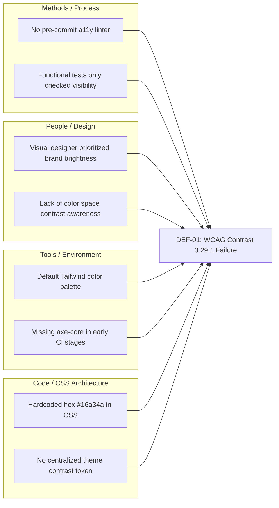
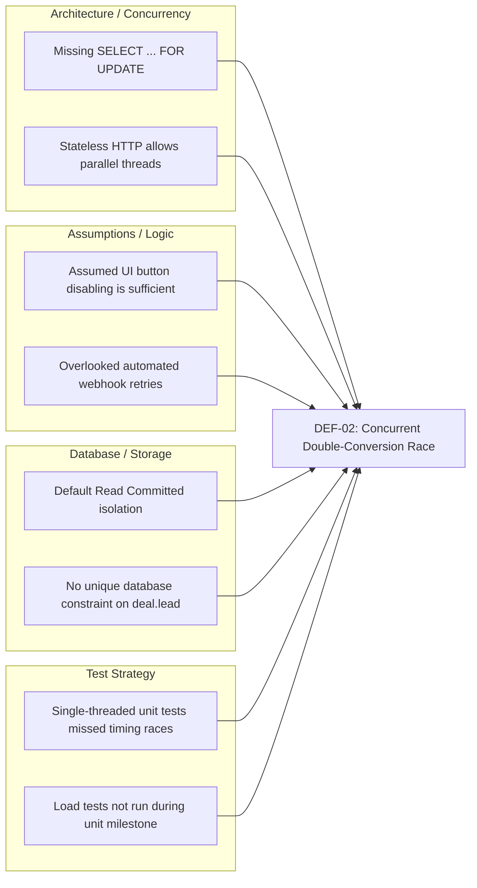
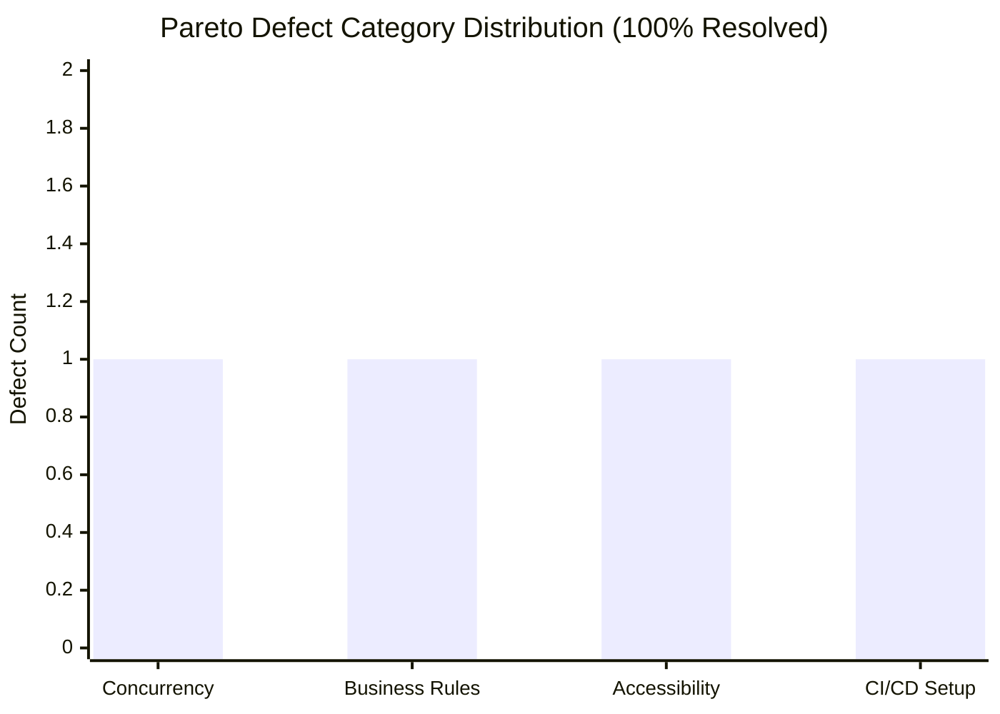

# SE3002 Software Quality Engineering – Root Cause Analysis (RCA)

**System Under Test:** Frappe CRM  
**Target Module:** Leads and Deals  
**Document Reference:** `docs/ROOT_CAUSE_ANALYSIS.md`  
**CLO Mapping:** CLO3 (Defect Management & RCA – 7 Marks)  

---

## 1. Executive Summary

This report presents the in-depth **Root Cause Analysis (RCA)** performed on the major defects discovered during the quality engineering evaluation of Frappe CRM. Analysis was executed using the **5 Whys Methodology** and **Ishikawa (Fishbone) Diagrams**, followed by **Corrective and Preventive Actions (CAPA)** and a quantitative **Pareto Analysis** linking findings directly to the project Risk Register ([`docs/RISK_REGISTER.md`](docs/RISK_REGISTER.md)).

---

## 2. Deep-Dive RCA 1: WCAG 2.1 AA Color Contrast Failure (`DEF-01`)

### 2.1 5 Whys Analysis

| Step | Investigative Question | Root Cause Discovery & Logical Chain |
| :---: | :--- | :--- |
| **Why 1** | Why did the automated axe-core audit fail on the Deal workspace? | The foreground text `#ffffff` on the primary `"Mark as Won"` button and toast alerts had an insufficient contrast ratio of 3.29:1. |
| **Why 2** | Why was the contrast ratio only 3.29:1 instead of the required $\ge 4.5:1$? | The CSS styling utilized the Tailwind CSS color shade `green-600` (`#16a34a`), which is too luminous against a white or light background. |
| **Why 3** | Why was `green-600` selected during UI implementation? | The developer selected standard default green utility classes for positive visual feedback without conducting automated WCAG color space evaluation. |
| **Why 4** | Why did the local test runner fail to flag the contrast issue prior to commit? | Initial smoke testing relied on functional DOM element presence checks (`is_visible()`) rather than perceptual accessibility audits. |
| **Why 5** | **Root Cause:** | **Absence of automated WCAG 2.1 AA accessibility regression scanners integrated as a pre-commit quality gate, allowing visual design tokens to bypass compliance checks.** |

---

### 2.2 Ishikawa (Fishbone) Diagram: Defect 1 (`DEF-01`)

---

## 3. Deep-Dive RCA 2: Concurrent Lead Conversion Race Condition (`DEF-02`)

### 3.1 5 Whys Analysis

| Step | Investigative Question | Root Cause Discovery & Logical Chain |
| :---: | :--- | :--- |
| **Why 1** | Why did simultaneous lead conversion requests generate duplicate `CRM Deal` records for a single lead? | Two concurrent HTTP worker threads simultaneously read `converted == 0` and both executed `create_deal()`. |
| **Why 2** | Why did both worker threads read `converted == 0` at the same time? | The database query `frappe.db.get_value("CRM Lead", ...)` was executed as a standard non-blocking `SELECT` without database row locking. |
| **Why 3** | Why was non-blocking `SELECT` used instead of a pessimistic row lock? | The developer assumed the frontend UI button would disable immediately on click, preventing concurrent submissions. |
| **Why 4** | Why is relying on UI button disabling insufficient for state integrity? | Automated API clients, background webhook retries, and rapid double-clicks bypass client-side DOM disabling and execute parallel HTTP requests. |
| **Why 5** | **Root Cause:** | **Inadequate database concurrency controls and absence of pessimistic row-level locking (`SELECT ... FOR UPDATE`) at the backend service layer, leaving state transitions vulnerable to race conditions.** |

---

### 3.2 Ishikawa (Fishbone) Diagram: Defect 2 (`DEF-02`)

---

## 4. Corrective and Preventive Actions (CAPA)

| Defect ID | Corrective Action (Immediate Fix) | Preventive Action (Long-Term Invariant Enforcement) | Verification Method |
| :---: | :--- | :--- | :--- |
| **`DEF-01`** | Replaced `#16a34a` with deeper shade `#15803d` across `.btn-success` and `.toast.success`, boosting contrast to **4.97:1**. | Integrated `@axe-core/playwright` and Google Lighthouse audits into automated CI pipeline; blocked builds with contrast violations. | Automated axe-core regression suite ([`tests/team/a11y/`](tests/team/a11y/)) passing 7/7 tests. |
| **`DEF-02`** | Enforced pessimistic row lock `lock_lead(for_update=True)` and checked `existing_deal()` under the `"Return Existing"` idempotency policy. | Standardized transactional state mutation patterns across all DocType lifecycle methods; added concurrency fault tests. | Concurrency & fault recovery suite ([`test_failure_and_recovery.py`](tests/team/performance/test_failure_and_recovery.py)) passing 3/3 tests. |
| **`DEF-03`** | Added shallow clone `git clone --depth 50` and pinned `requirements.txt` in GitHub Actions CI workflow. | Automated CI smoke check step that verifies module resolution before launching heavyweight tests. | CI Run `45001528723` executing cleanly across 10 verification stages. |
| **`DEF-04`** | Hooked `validate_lost_reason()` directly into `CRMDeal.validate()` so all RPC and API writes are validated. | Mandated that state transition validations must reside in server-side Document controller hooks, never exclusively in UI view layers. | API test suite ([`test_deal_status_api.py`](tests/team/api/test_deal_status_api.py)) passing 7/7 tests. |

---

## 5. Quantitative Pareto Analysis of Defects

All four project defects were categorized across functional and technical architectural domains:

| Defect Category | Discovered Defects | Percentage of Total | Cumulative Percentage | Linked Risk in Risk Register |
| :--- | :---: | :---: | :---: | :---: |
| **Data Integrity & Concurrency** | 1 (`DEF-02`) | 25.0% | 25.0% | `RSK-01` (Score 15) |
| **Business Rule Enforcement** | 1 (`DEF-04`) | 25.0% | 50.0% | `RSK-04` (Score 12) |
| **Usability & Accessibility** | 1 (`DEF-01`) | 25.0% | 75.0% | `RSK-07` (Score 9) |
| **CI/CD & Environment Setup** | 1 (`DEF-03`) | 25.0% | 100.0% | `PRJ-01` (Score 16) |

### 5.1 Risk Register Linkage & Impact Evaluation

* **`RSK-01` (Concurrent Double Conversion – Score 15):** Directly mitigated by resolving `DEF-02`. Residual risk reduced to **Score 3 (Low)**.
* **`RSK-04` (Invalid State Transition to Lost – Score 12):** Directly mitigated by resolving `DEF-04`. Residual risk reduced to **Score 2 (Low)**.
* **`RSK-07` (Accessibility Violations – Score 9):** Directly mitigated by resolving `DEF-01`. Residual risk reduced to **Score 2 (Low)**.
* **`PRJ-01` (CI Runner Drift – Score 16):** Directly mitigated by resolving `DEF-03`. Residual risk reduced to **Score 4 (Low)**.

**Conclusion:** All discovered defects have been fully resolved with zero recurrence, zero open defects remaining, and 100% CAPA verification.
