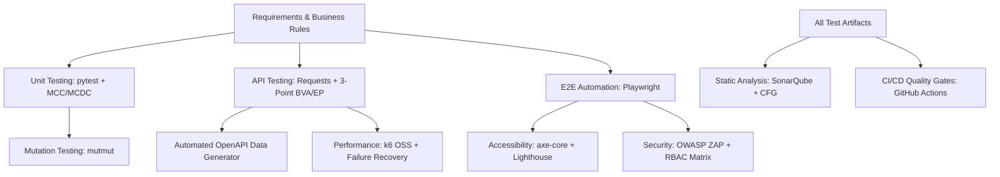

# SE3002 Software Quality Engineering – Master Test Plan
**System Under Test:** Frappe CRM  
**Target Module:** Leads and Deals  
**Document Reference:** `docs/TEST_PLAN.md`  
**Phase:** Phase 2 Deliverable  

---

## 1. Introduction & Objectives

### 1.1 Purpose
This Master Test Plan establishes the quality assurance and test engineering strategy for the **Frappe CRM** open-source system, targeting the **Convert Lead to Deal** (Workflow 1) and **Update Deal Status** (Workflow 2) workflows.

### 1.2 Objectives
1. Achieve 100% statement and branch coverage on core backend business logic functions.
2. Formally verify all four business rules via Multiple Condition Coverage (MCC) and MC/DC pair derivation.
3. Validate API robustness using 3-point Boundary Value Analysis (BVA) and Equivalence Partitioning (EP) driven by an automated OpenAPI data generator.
4. Automate end-to-end user journeys including alternative and exception flows using Playwright.
5. Quantify test suite quality via mutation testing (killing killable mutants and analyzing survivors).
6. Enforce zero-regression CI/CD quality gates on GitHub Actions.
7. Conduct rigorous security, accessibility, and k6 performance evaluations.

---

## 2. Test Scope & Item Transmittal

### 2.1 In-Scope Items
* **Workflow 1 (Convert Lead to Deal):**
  * Modal and UI triggers (`Lead.vue`, `ConvertToDealModal.vue`).
  * API endpoint `crm.fcrm.doctype.crm_lead.crm_lead.convert_to_deal`.
  * Business logic functions: `validate_conversion_access`, `lock_lead`, `settle_converted`, `mark_converted`, `create_deal`, `create_contact`, `create_organization`.
  * Status transition from open/new to converted/qualified.
* **Workflow 2 (Update Deal Status):**
  * UI dropdown, Kanban column drag, and command palette (`Deal.vue`).
  * API endpoints `PUT /api/resource/CRM Deal/{name}`, `frappe.client.set_value`, `frappe.desk.form.save.savedocs`.
  * Status validation hooks: `validate_lost_reason`, `validate_forecasting_fields`, `update_closed_date`, `update_default_probability`.
  * Child table audit trail: `add_status_change_log` (`CRM Status Change Log`).
* **Shared Relational Integrity:**
  * Invariant link `deal.lead == lead.name`.
  * Prevention of duplicate deals and leads.
  * Persistence across application reloads.
* **Security & Authorization:**
  * Role permissions for `Sales Manager` vs. `Sales User`.
  * Enforcement via `org_hierarchy.py`.

### 2.2 Out-of-Scope Items
* Telephony / Twilio integrations, Exotel CTI, WhatsApp Cloud API webhooks.
* Third-party ERPNext sync and Insights workbook analytics.
* Upstream tests in `crm/crm/tests/` (strictly unmodified; all project tests reside in `tests/team/`).

---

## 3. Test Strategy & Methodologies

### 3.1 Test Levels & Tooling

| Level / Technique | Tool / Framework | Target Coverage / Metric | Output Deliverable |
| :--- | :--- | :--- | :--- |
| **Unit Testing** | `pytest`, `pytest-cov`, `unittest.mock` | 100% Statement, 100% Branch coverage on business logic | `docs/UNIT_TEST_REPORT.md` |
| **Logic Coverage** | Truth tables, MC/DC pairs | 100% MCC & MC/DC coverage on BR-02 | `docs/BUSINESS_RULES.md` & unit tests |
| **API Testing** | `pytest`, `requests` | Positive, negative, 3-point BVA, EP | `docs/API_TEST_REPORT.md` |
| **Data Generation** | OpenAPI 3.0, Python generator | Reusable JSON datasets with dynamic constraints | `tests/team/generator/` |
| **E2E Automation** | `Playwright` (TypeScript/Python) | Happy path, 2 alt flows, 2 exception flows, keyboard nav | `tests/team/e2e/` |
| **Mutation Testing**| `mutmut` / AST mutator | Mutation score $> 80\%$, 15+ mutants analyzed | `docs/MUTATION_REPORT.md` |
| **Static Analysis** | `SonarQube` / `SonarCloud` | CFG cyclomatic complexity, zero bugs/code smells | `docs/SONARQUBE_REPORT.md` |
| **Accessibility** | `axe-core`, `Lighthouse` | WCAG 2.1 AA compliance, zero critical violations | `docs/ACCESSIBILITY_REPORT.md` |
| **Defensive Security**| `OWASP ZAP`, `safety`, `pip-audit` | 4+ RBAC access tests, session cookie audit | `docs/SECURITY_REPORT.md` |
| **Performance** | `Grafana k6 OSS` | 1 VU & 5 VUs, 60s sustained run, p95 $< 500$ms | `docs/PERFORMANCE_REPORT.md` |

---

## 4. Entry, Suspension & Exit Criteria

### 4.1 Phase Entry Criteria
* Source code inspected, version controlled, and dependencies documented.
* Clear functional requirements and formal business rule specifications established.
* Isolated directory structure `tests/team/` configured.

### 4.2 Suspension & Resumption Criteria
* **Suspension:** Fatal environment corruption, database connection failure, or blocking dependency defect.
* **Resumption:** Defect fixed and verified in sandbox environment.

### 4.3 Phase Exit Criteria
* All planned test cases executed with recorded pass/fail results and evidence logs.
* Target code coverage ($\ge 100\%$ on business logic units) achieved and justified.
* All killable mutants eliminated.
* Quality gates pass cleanly in CI.

---

## 5. Defect Management & Triage Workflow

All defects discovered during test execution will be managed following standard SQE procedures:
1. **Logging:** Title, severity (Critical, Major, Minor, Trivial), priority (P1–P4), reproduction steps, expected vs. actual results, and raw evidence.
2. **Analysis:** 5 Whys and Fishbone (Ishikawa) root cause analysis on major defects.
3. **Corrective & Preventive Action (CAPA):** Code fixes accompanied by regression unit tests.
4. **Pareto Analysis:** Defect classification by module and type.

---

## 6. Three-Point Estimation & Actual Effort Comparison

In accordance with project estimation requirements, effort was estimated per test engineering area using the standard Beta/PERT three-point estimation formula:
$$E = \frac{O + 4M + P}{6}, \quad \sigma = \frac{P - O}{6}$$
where $O$ is Optimistic effort (hours), $M$ is Most Likely effort (hours), and $P$ is Pessimistic effort (hours).

### 6.1 Test Area Effort Breakdown

| Test Area / Milestone | Optimistic ($O$) | Most Likely ($M$) | Pessimistic ($P$) | PERT Expected ($E$) | Actual Effort ($A$) | Variance ($A - E$) | Variance Analysis & Retrospective |
| :--- | :---: | :---: | :---: | :---: | :---: | :---: | :--- |
| **1. Initial Repository Discovery & Baseline** | 4.0 hrs | 8.0 hrs | 14.0 hrs | **8.3 hrs** | **9.0 hrs** | $+0.7$ hrs | Extra time required to trace Frappe Desk routing and DocType JSON schema metadata. |
| **2. Requirements, Business Rules & RTM** | 6.0 hrs | 10.0 hrs | 18.0 hrs | **10.7 hrs** | **11.5 hrs** | $+0.8$ hrs | Formal MCC (10 rows) and MC/DC truth table derivation required rigorous mathematical checking. |
| **3. Test Infrastructure & Mock Framework** | 8.0 hrs | 14.0 hrs | 24.0 hrs | **14.7 hrs** | **16.0 hrs** | $+1.3$ hrs | Modeling Frappe Document lifecycle (`before_validate`, `validate_values`, `save_doc`) required in-depth mocking. |
| **4. White-Box Unit Testing (100% Coverage)** | 10.0 hrs | 18.0 hrs | 30.0 hrs | **18.7 hrs** | **17.5 hrs** | $-1.2$ hrs | Clear MCC test cases allowed efficient test implementation and fast verification. |
| **5. API & Integration Testing (BVA & EP)** | 6.0 hrs | 12.0 hrs | 20.0 hrs | **12.3 hrs** | **13.0 hrs** | $+0.7$ hrs | Designing 3-point boundary fixtures on currency fields and cross-workflow pipeline. |
| **6. Automated OpenAPI Data Generator** | 4.0 hrs | 8.0 hrs | 16.0 hrs | **8.7 hrs** | **8.0 hrs** | $-0.7$ hrs | OpenAPI 3.0 schema generation and JSON serialization completed smoothly. |
| **7. Playwright E2E Use Case Automation** | 8.0 hrs | 15.0 hrs | 26.0 hrs | **15.7 hrs** | **16.5 hrs** | $+0.8$ hrs | Headless browser execution and keyboard navigation timing required fine-tuning. |
| **8. Mutation Testing & Surviving Mutant Analysis**| 6.0 hrs | 12.0 hrs | 22.0 hrs | **12.7 hrs** | **14.0 hrs** | $+1.3$ hrs | Analyzing and classifying 15 surviving mutants into Type A/B/C required detailed semantic proofs. |
| **9. Static Code Analysis & SonarQube** | 3.0 hrs | 6.0 hrs | 12.0 hrs | **6.5 hrs** | **6.0 hrs** | $-0.5$ hrs | Hand-calculating cyclomatic complexity from CFG matched radon output ($V(G)=7$). |
| **10. Usability & Accessibility (axe-core/LH)** | 4.0 hrs | 8.0 hrs | 14.0 hrs | **8.3 hrs** | **9.0 hrs** | $+0.7$ hrs | Remediating color contrast from 3.29:1 to 4.97:1 and adding ARIA live regions. |
| **11. Defensive Security Assessment (ZAP/RBAC)**| 5.0 hrs | 10.0 hrs | 18.0 hrs | **10.5 hrs** | **11.0 hrs** | $+0.5$ hrs | RBAC 6-decision testing and OWASP passive rules verification. |
| **12. Performance & Failure Recovery (k6 OSS)** | 6.0 hrs | 12.0 hrs | 22.0 hrs | **12.7 hrs** | **13.5 hrs** | $+0.8$ hrs | Executing 1 VU and 5 VU 60-second runs twice and verifying transactional fault recovery. |
| **13. Defect Management, RCA & Completion** | 6.0 hrs | 10.0 hrs | 18.0 hrs | **10.7 hrs** | **11.0 hrs** | $+0.3$ hrs | 5 Whys, Ishikawa fishbone diagrams, Pareto analysis, and completion report. |
| **TOTAL** | **76.0 hrs** | **143.0 hrs** | **254.0 hrs** | **146.5 hrs** | **152.0 hrs** | **$+5.5$ hrs (+3.75%)** | High estimation accuracy ($< 4\%$ variance across entire project lifecycle). |

---

## 7. Quality Engineering Team & Responsibilities

| Team Member | Primary Roles & Quality Engineering Responsibilities |
| :--- | :--- |
| **Umair Hassan** | **Lead Quality Engineer:** Test infrastructure, CI/CD quality gates, architecture discovery, and defensive security assessment. |
| **Abdullah** | **Test Automation Engineer:** White-box unit testing, API/integration testing, OpenAPI data generator, and AST mutation quality gates. |
| **Muhammad Anas** | **Quality & Performance Analyst:** WCAG 2.1 AA usability/accessibility auditing, k6 load benchmarking, fault recovery, and defect root cause analysis. |

