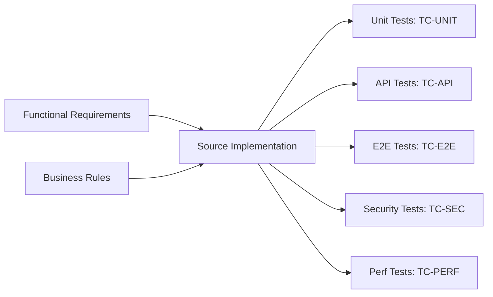

# SE3002 Software Quality Engineering – Requirements Traceability Matrix (RTM)
**System Under Test:** Frappe CRM  
**Target Module:** Leads and Deals  
**Document Reference:** `docs/TRACEABILITY_MATRIX.md`  
**Milestone:** Milestone 2 Deliverable  

---

## 1. Traceability Architecture

The Bidirectional Traceability Matrix links every Functional Requirement (FR) and Business Rule (BR) to its source code implementation, test level, test case IDs, and verification deliverables.

---

## 2. Requirements Traceability Matrix (RTM)

| Req ID | Business Rule | Requirement Summary | Implementation File & Lines | Test Case ID(s) | Test Level | Target Milestone |
| :---: | :---: | :--- | :--- | :--- | :---: | :---: |
| **FR-LC-01** | BR-04 | Convert Lead to Deal (valid flow, entity creation, field mapping) | `crm/crm/fcrm/doctype/crm_lead/crm_lead.py:548-577, 357-440` | `TC-UNIT-LC-01`, `TC-API-LC-01`, `TC-E2E-LC-01` | Unit, API, E2E | Milestone 4, 5, 7 |
| **FR-LC-02** | BR-04 | Reject conversion of Lost lead & unauthorized user | `crm/crm/fcrm/doctype/crm_lead/crm_lead.py:568-569, 579-584` | `TC-UNIT-LC-02`, `TC-API-LC-02`, `TC-E2E-LC-EX1` | Unit, API, E2E | Milestone 4, 5, 7 |
| **FR-LC-03** | BR-04 | Row lock, idempotency & duplicate prevention policy | `crm/crm/fcrm/doctype/crm_lead/crm_lead.py:564-567, 586-602` | `TC-UNIT-LC-03`, `TC-API-LC-03`, `TC-PERF-REC-01` | Unit, API, Perf | Milestone 4, 5, 12 |
| **FR-DS-01** | BR-03 | Deal transition to Won (closed_date set to nowdate(), probability updated) | `crm/crm/fcrm/doctype/crm_deal/crm_deal.py:103-104, 250-263` | `TC-UNIT-DS-01`, `TC-API-DS-01`, `TC-E2E-DS-01` | Unit, API, E2E | Milestone 4, 5, 7 |
| **FR-DS-02** | BR-02 | Deal transition to Lost (lost_reason mandatory; notes required if Other) | `crm/crm/fcrm/doctype/crm_deal/crm_deal.py:285-296` | `TC-UNIT-DS-02` (MCC/MCDC), `TC-API-DS-02`, `TC-E2E-DS-EX1` | Unit, API, E2E | Milestone 4, 5, 7 |
| **FR-DS-03** | — | Status change audit logging (child table, duration tracking, log owner) | `crm/crm/fcrm/doctype/crm_status_change_log/crm_status_change_log.py:45-85` | `TC-UNIT-DS-03`, `TC-API-DS-03`, `TC-E2E-DS-02` | Unit, API, E2E | Milestone 4, 5, 7 |
| **FR-SH-01** | — | Cross-workflow shared data consistency (lead link preservation, no duplicates) | `crm/crm/fcrm/doctype/crm_deal/crm_deal.py:407`, `crm_lead.py:574` | `TC-UNIT-SH-01`, `TC-API-SH-01`, `TC-E2E-SH-01` | Unit, API, E2E | Milestone 4, 5, 7 |
| **FR-AU-01** | — | RBAC enforcement: Sales Manager vs. Sales User scoped access | `crm/crm/permissions/org_hierarchy.py:17-61` | `TC-UNIT-AU-01`, `TC-API-AU-01`, `TC-SEC-01`, `TC-SEC-02` | Unit, API, Security | Milestone 4, 5, 11 |
| **FR-FC-01** | BR-01 | Forecasting mandatory fields & non-negative currency boundaries | `crm/crm/fcrm/doctype/crm_deal/crm_deal.py:275-284, 568-573` | `TC-UNIT-BR1-BVA`, `TC-API-BVA-01`, `TC-GEN-01` | Unit, API, Data Gen | Milestone 4, 5, 6 |

---

## 3. Business Rule to Test Case Coverage

| Business Rule | Rule Classification | Coverage Goal | Assigned Test Cases | Verification Evidence |
| :---: | :--- | :--- | :--- | :--- |
| **BR-01** | Boundary / Limit | 3-Point Boundary Value Analysis ($-0.01, 0.00, +0.01$) | `TC-UNIT-BR1-BVA`, `TC-API-BVA-01` | `docs/UNIT_TEST_REPORT.md` |
| **BR-02** | Decision with 2+ Boolean Conditions | 100% Multiple Condition Coverage (MCC) & MC/DC | `TC-UNIT-MCC-01` through `TC-UNIT-MCC-10`, `TC-UNIT-MCDC-01`..`04` | `docs/UNIT_TEST_REPORT.md`, `docs/MUTATION_REPORT.md` |
| **BR-03** | State Change Rule | Positive/negative state transition & date assertion | `TC-UNIT-DS-01`, `TC-API-DS-01`, `TC-E2E-DS-01` | `docs/UNIT_TEST_REPORT.md`, `docs/API_TEST_REPORT.md` |
| **BR-04** | Status Gate & Idempotency Rule | Ineligible rejection & 3 idempotent settle policies | `TC-UNIT-LC-02`, `TC-UNIT-LC-03`, `TC-API-LC-02`, `TC-API-LC-03` | `docs/UNIT_TEST_REPORT.md`, `docs/API_TEST_REPORT.md` |
