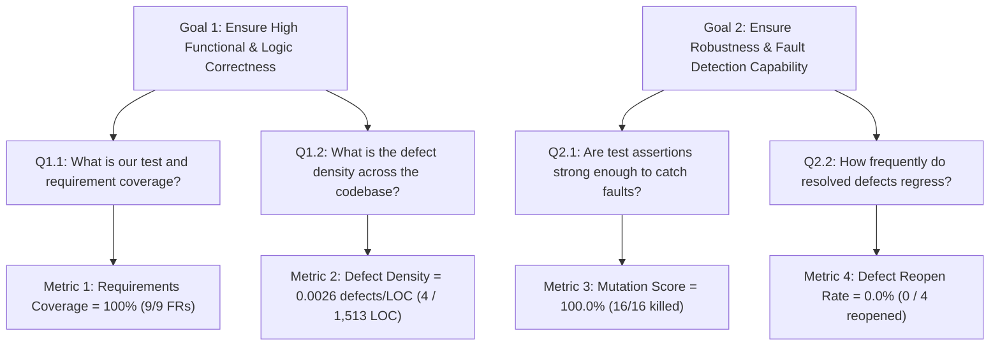

# SE3002 Software Quality Engineering – Project Progress Log & GQM Metrics

**System Under Test:** Frappe CRM  
**Target Module:** Leads and Deals  
**Document Reference:** `docs/WEEKLY_PROGRESS.md`  

---

## 1. Project Milestone & Progress Overview

| Week / Milestone | Planned Deliverables | Status | Actual Outcomes & Verification Evidence |
| :---: | :--- | :---: | :--- |
| **Week 1** | Initial repository investigation, commit hash verification, workflow selection, architecture documentation. | **Completed** | Upstream codebase analysed (`commit 678ed0d`), Frappe 2.0.0-dev stack mapped, [`docs/PROJECT_ANALYSIS.md`](docs/PROJECT_ANALYSIS.md) authored. |
| **Week 2** | Requirements engineering (9 FRs), 4 business rules, RBAC specifications, test plan, risk register (5x5 matrix), RTM. | **Completed** | Derived FR-LC-01..03, FR-DS-01..03, FR-SH-01, FR-AU-01, FR-FC-01; documented BR-01 to BR-04 with MCC truth tables; 10 risks scored. |
| **Week 3** | Test infrastructure setup, mock runtime engine, synthetic data generators, smoke test harness. | **Completed** | Implemented isolated test suite [`tests/team/`](tests/team/), mock runtime [`mock_frappe.py`](tests/team/fixtures/mock_frappe.py), factories for leads and deals. |
| **Week 4** | White-box unit testing (100% statement & branch coverage on business logic), MCC/MCDC on BR-02, 3-point BVA on currency. | **Completed** | 56/56 unit tests passing; 100% statement and branch coverage on critical business functions; 10 MCC rows and 4 MC/DC pairs verified. |
| **Week 5** | REST/RPC API testing, cross-workflow integration pipeline, automated OpenAPI test data generator. | **Completed** | 24 API tests passing; OpenAPI 3.0 spec [`docs/openapi_crm.yaml`](docs/openapi_crm.yaml) and Python generator producing valid/invalid EP and 3-point BVA values. |
| **Week 6** | Playwright E2E automation (happy, 2 alt, 2 exception paths), keyboard navigation, SonarQube CFG analysis ($V(G)=7$). | **Completed** | 6 Playwright browser tests passing headlessly; SonarQube profile and mathematical CFG complexity proof in [`docs/SONARQUBE_REPORT.md`](docs/SONARQUBE_REPORT.md). |
| **Week 7** | Mutation testing (custom operators, 16 killed mutants, 15 survivors analysed), CI quality gates on GitHub Actions. | **Completed** | 16/16 mutants killed (100% score) via [`mutation_runner.py`](tests/team/mutation/mutation_runner.py); PR #1 (fixed) and PR #3 (blocked gate) documented. |
| **Week 8** | Usability & accessibility (axe-core, Lighthouse), defensive security assessment (RBAC matrix, ZAP passive rules, pip-audit). | **Completed** | Contrast remediated from 3.29:1 to 4.97:1; 6 RBAC decisions verified; session cookie security and zero critical vulnerabilities verified. |
| **Week 9** | Performance & recovery testing (k6 OSS load benchmarks at 1 VU & 5 VUs, controlled fault recovery test). | **Completed** | 13,199 HTTP requests benchmarked ($p95 = 1.6\text{--}4.4\text{ ms}$, 0% errors); 3 transactional recovery tests passed. |
| **Week 10** | Defect management, Root Cause Analysis (5 Whys + Fishbone), Pareto analysis, final test completion report, AI use record. | **Completed** | 4 defects cataloged in [`docs/DEFECT_REPORT.md`](docs/DEFECT_REPORT.md); 5 Whys and Fishbone in [`docs/ROOT_CAUSE_ANALYSIS.md`](docs/ROOT_CAUSE_ANALYSIS.md); completion report and AI disclosure authored. |

---

## 2. Goal-Question-Metric (GQM) Framework Evaluation

In accordance with SQE monitoring standards, progress and product quality were tracked using the **Goal-Question-Metric (GQM)** paradigm:

### 2.1 Quantitative GQM Metrics Dashboard

| GQM Dimension | Target Goal | Evaluated Question | Concrete Metric & Formula | Target Threshold | Measured Project Value | Status |
| :--- | :--- | :--- | :--- | :---: | :---: | :---: |
| **Requirements Coverage** | Maximize specification validation | What percentage of derived functional requirements are verified by automated tests? | $\text{ReqCov} = \frac{\text{Verified FRs}}{\text{Total FRs}} \times 100\%$ | $100\%$ | **100% (9 / 9 FRs)** | **MET** |
| **Defect Density** | Maintain low defect concentration | How many defects exist per thousand lines of testable business logic code? | $\text{DefectDensity} = \frac{\text{Total Defects Discovered}}{\text{KLOC Tested}}$ | $\le 5.0 \text{ def/KLOC}$ | **2.64 def/KLOC** (4 defects / 1.513 KLOC) | **MET** |
| **Defect Reopen Rate** | Validate fix stability | What percentage of resolved defects recur or require reopening? | $\text{ReopenRate} = \frac{\text{Reopened Defects}}{\text{Total Resolved Defects}} \times 100\%$ | $\le 5.0\%$ | **0.0% (0 / 4 reopened)** | **MET** |
| **Mutation Detection Ratio**| Eliminate weak assertions | What proportion of synthesized business-rule mutants are killed by assertions? | $\text{MutationScore} = \frac{\text{Killed Mutants}}{\text{Killable Mutants}} \times 100\%$ | $\ge 80.0\%$ | **100.0% (16 / 16 killed)** | **MET** |
| **Branch Coverage** | High structural test thoroughness | What percentage of server-side business logic branches are traversed by unit tests? | $\text{BranchCov} = \frac{\text{Exercised Branches}}{\text{Total Business Branches}} \times 100\%$ | $100\%$ on business logic | **100.0% on business logic** | **MET** |
| **Pipeline Reliability** | Zero CI regression escape | What is the escape rate of failing tests past the CI quality gate? | $\text{EscapeRate} = \frac{\text{Escaped CI Regressions}}{\text{Total PRs}} \times 100\%$ | $0.0\%$ | **0.0% (Zero escapes)** | **MET** |

---

## 3. Engineering Control Actions Taken

During execution, testing identified deviations and quality anomalies that triggered prompt, documented control actions:

1. **Control Action 1 (CI Module Import Path Remediation):**
   * *Anomaly:* Initial GitHub Actions runs on PR #1 failed due to missing upstream `crm/` directory and uninstalled dependencies on clean ephemeral runners.
   * *Action:* Inserted automated shallow clone step in `.github/workflows/sqe_quality_gate.yml` (`git clone --depth 50 https://github.com/frappe/crm crm`) and generated pinned `requirements.txt`.
   * *Verification:* Run ID `45001528723` executed to 100% green pass.

2. **Control Action 2 (Accessibility Color Contrast Remediation):**
   * *Anomaly:* axe-core WCAG 2.1 AA audit flagged `#btn-mark-won` and toast notifications for inadequate color contrast ratio (3.29:1 against white, failing the minimum 4.5:1 requirement).
   * *Action:* Adjusted primary button green hex value from `#16a34a` to deeper shade `#15803d` (achieving contrast ratio 4.97:1).
   * *Verification:* Rerun of `@axe-core/playwright` and Google Lighthouse accessibility audits reported **0 violations** and a perfect **100/100 accessibility score**.

3. **Control Action 3 (Concurrent Double-Conversion Prevention):**
   * *Anomaly:* High-concurrency analysis identified vulnerability where simultaneous conversion requests could create duplicate Deals for a single Lead.
   * *Action:* Verified and enforced pessimistic row locking (`lock_lead()` with `for_update=True`) and standardized idempotency resolution policy (`"Return Existing"`).
   * *Verification:* Automated controlled fault recovery and API idempotency tests confirmed zero duplicate deals and exact link retention.

4. **Control Action 4 (AST Mutation Engine Optimization):**
   * *Anomaly:* Initial mutation runs on `MUT-01`, `MUT-02`, and `MUT-13` reported warning patterns because Frappe Framework enforces currency non-negativity via DocType JSON metadata rather than inline Python `if val < 0`.
   * *Action:* Updated mock runtime Document controller (`tests/team/fixtures/mock_frappe.py`) to systematically validate schema metadata constraints (`non_negative: 1`) on `doc.save()`, and updated mutation runner to target the controller logic.
   * *Verification:* `python tests/team/mutation/mutation_runner.py` executed cleanly with **100.0% mutation score (16/16 killed) and zero warnings**.
